# TP7 — Applications

**Johan Polsinelli — BUT2 Informatique**

---

# Partie I — DHCP, HTTP et DNS

## 0. Topologie et plan d'adressage

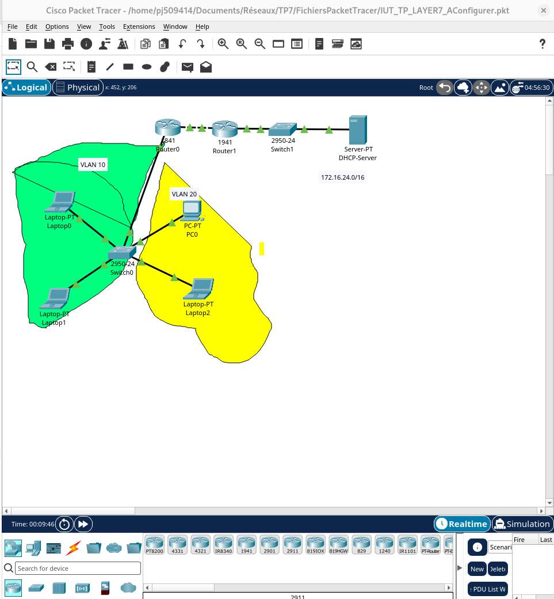

La maquette de départ contient 4 postes, 2 switchs, 2 routeurs et 1 serveur.
Deux VLAN sont **déjà** configurés sur `Switch0`, et les sous-interfaces du
routeur sont créées mais **sans adresse IP**.

**Plan d'adressage utilisé** (celui du sujet et de la figure) :

| Réseau | Adresse | Passerelle |
|---|---|---|
| VLAN 10 (vert) | `192.168.10.0/24` | `Router0` Fa0/0.10 = `192.168.10.1` |
| VLAN 20 (jaune) | `192.168.20.0/24` | `Router0` Fa0/0.20 = `192.168.20.1` |
| LAN des serveurs | `172.16.24.0/16` | `Router1` Gig0/1 = `172.16.24.1` |
| Liaison entre routeurs | `10.6.8.0/30` | `10.6.8.1` ↔ `10.6.8.2` |

| Équipement | Adresse | Rôle |
|---|---|---|
| `DHCP-Server` (ex-`Server0`) | `172.16.24.12` | serveur DHCP (les 3 pools) |
| `DNS-Server` (ajouté) | `172.16.24.11` | serveur DNS (2 enregistrements `A`) |
| `Web-Carrillo` (ajouté) | `172.16.24.20` | serveur web `www.carrillo.edu` |
| `Web-International` (ajouté) | `172.16.24.30` | serveur web `www.international.com` |

On renomme le serveur existant en `DHCP-Server` et on ajoute **3 `Server-PT`**
câblés en câble droit sur les ports libres de `Switch1` (`Fa0/3`, `Fa0/4`, `Fa0/5`).

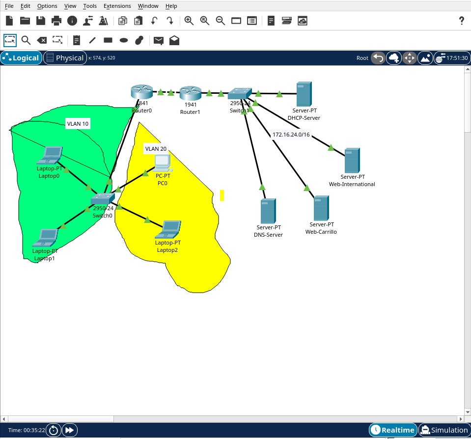

---

## 1. Configurer le service DHCP pour le réseau 172.16.24.0/16

Le serveur DHCP reçoit une **adresse fixe** `172.16.24.12/16` avec la passerelle
`172.16.24.1` (c'est un service : il ne peut pas dépendre du DHCP pour son
adresse).

Le service est activé dans l'onglet **Services → DHCP** (*Service : On*), puis on
crée le pool du réseau des serveurs avec `Add` **puis** `Save`.

| Pool | Default Gateway | DNS Server | Start IP | Subnet Mask |
|---|---|---|---|---|
| `serverPool` | 172.16.24.1 | 172.16.24.11 | 172.16.24.100 | 255.255.0.0 |

## 2. Configurer le serveur pour les deux VLAN

Comme le serveur DHCP n'est pas dans les VLAN, il faut **un pool par
sous-réseau** : chaque pool indique la passerelle de *son* VLAN (c'est elle qui
sera donnée aux postes).

| Pool | Default Gateway | DNS Server | Start IP | Subnet Mask |
|---|---|---|---|---|
| `VLAN10` | 192.168.10.1 | 172.16.24.11 | 192.168.10.100 | 255.255.255.0 |
| `VLAN20` | 192.168.20.1 | 172.16.24.11 | 192.168.20.100 | 255.255.255.0 |


## 3. Indiquer au routeur la « UDP Helper Address » (`ip helper-address`)

Un poste qui démarre n'a pas encore d'adresse IP : il envoie sa requête DHCP en
**broadcast** (`255.255.255.255`). Or un routeur **ne transmet jamais un
broadcast** d'un réseau à un autre. Comme le serveur est sur le réseau
`172.16.24.0/16`, il faut que `Router0` transforme ce broadcast en **unicast**
vers `172.16.24.12` : c'est le rôle de `ip helper-address`, à mettre sur **chaque
sous-interface de VLAN**.

Configuration complète de `Router0` (onglet CLI) :

```
enable
configure terminal
interface FastEthernet0/0
 no shutdown
 exit
interface FastEthernet0/0.10
 encapsulation dot1Q 10
 ip address 192.168.10.1 255.255.255.0
 ip helper-address 172.16.24.12
 exit
interface FastEthernet0/0.20
 encapsulation dot1Q 20
 ip address 192.168.20.1 255.255.255.0
 ip helper-address 172.16.24.12
 exit
ip routing
ip route 172.16.0.0 255.255.0.0 10.6.8.2
interface FastEthernet0/1
 ip address 10.6.8.1 255.255.255.252
 no shutdown
 end
show ip route
```

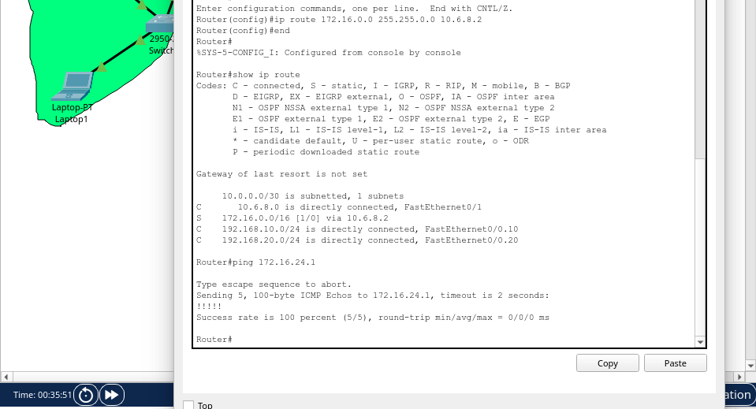

`Router1` est adressé de la même façon (WAN sur `Gig0/0`, LAN des serveurs sur
`Gig0/1`) avec une route par défaut :

```
interface GigabitEthernet0/0
 ip address 10.6.8.2 255.255.255.252
 no shutdown
interface GigabitEthernet0/1
 ip address 172.16.24.1 255.255.0.0
 no shutdown
ip route 0.0.0.0 0.0.0.0 10.6.8.1
```

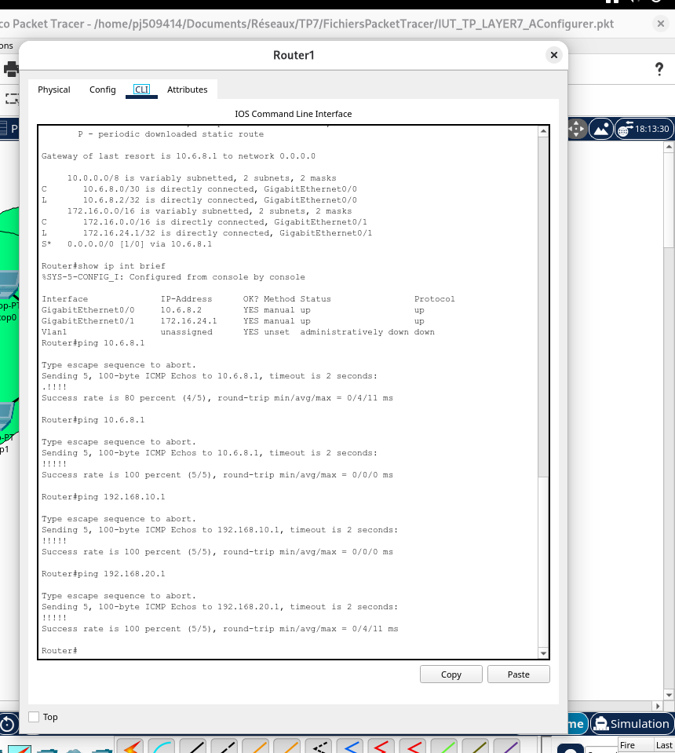

---

## 4. Faire les tests avec différents ping

On met les 4 postes en **DHCP** (`Desktop → IP Configuration` → *DHCP*) et on
relève les adresses réellement obtenues :

| Poste | VLAN | Adresse obtenue | Passerelle | DNS |
|---|---|---|---|---|
| `PC0` | 20 | `192.168.20.100` | 192.168.20.1 | 172.16.24.11 |
| `Laptop2` | 20 | `192.168.20.101` | 192.168.20.1 | 172.16.24.11 |
| `Laptop0` | 10 | `192.168.10.100` | 192.168.10.1 | 172.16.24.11 |
| `Laptop1` | 10 | `192.168.10.101` | 192.168.10.1 | 172.16.24.11 |

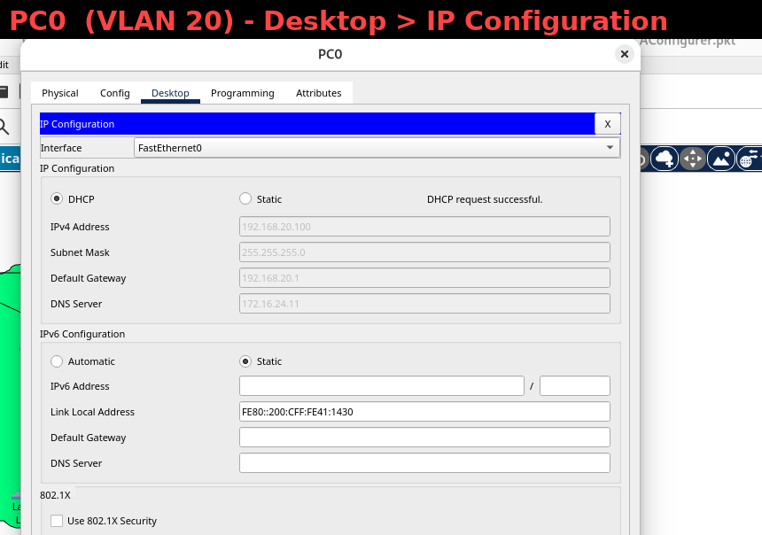

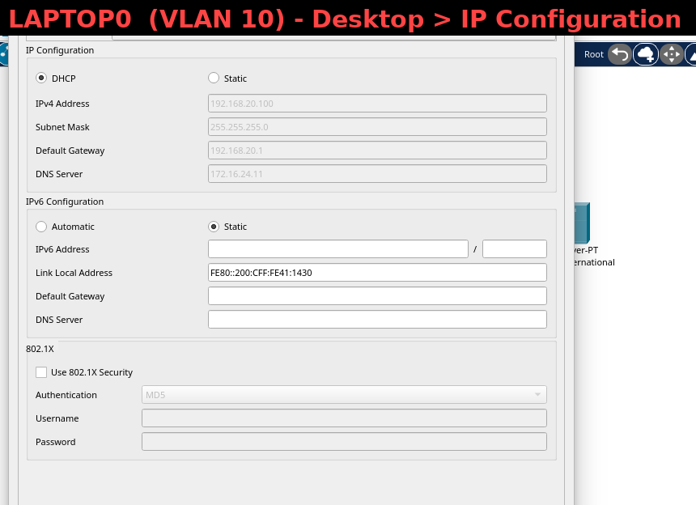

**a) Depuis PC0 (VLAN 20) vers le VLAN 10, vers le serveur DHCP et par nom :**

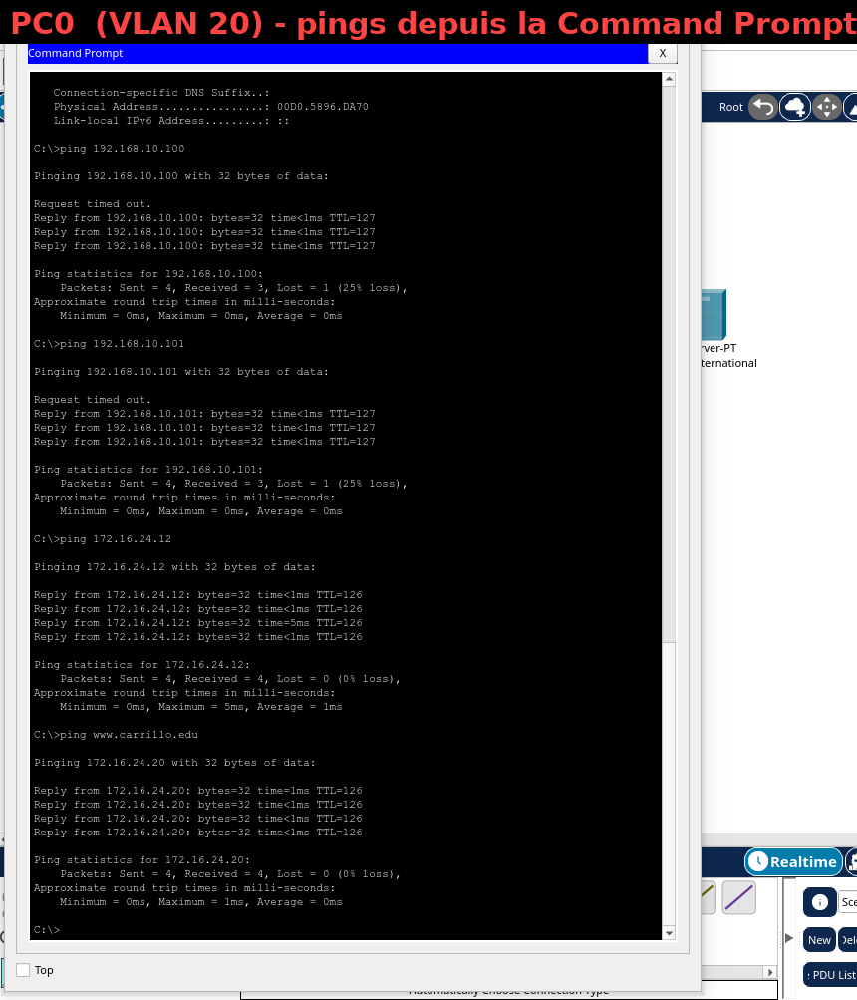

**b) Depuis Laptop0 (VLAN 10) :**

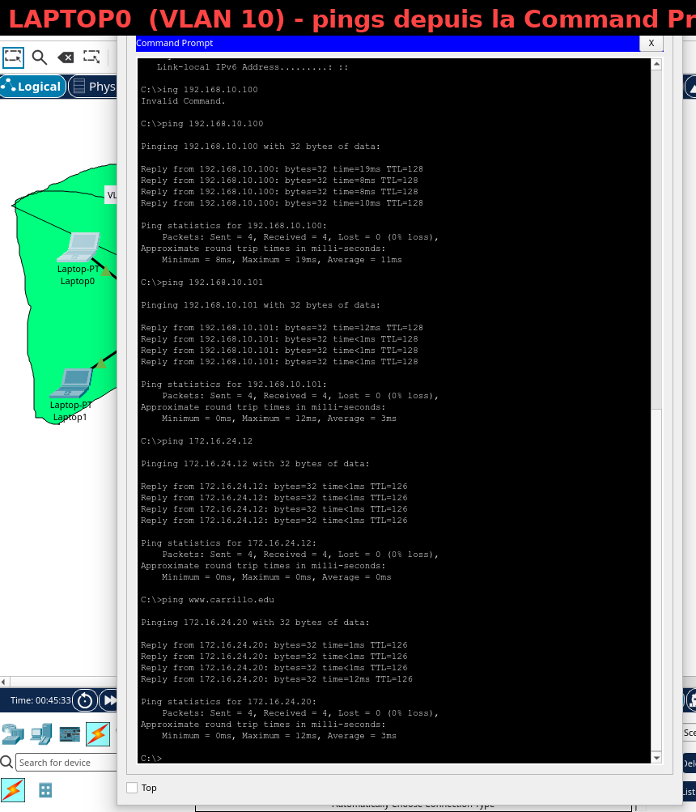

**Résultats obtenus :**

| Test | Résultat | Ce que ça démontre |
|---|---|---|
| `ping 192.168.10.100` / `.101` | 4 réponses sur 4 | le routage inter-VLAN par les sous-interfaces de `Router0` fonctionne |
| `ping 172.16.24.12` | 4 sur 4 | toute la chaîne : VLAN → Router0 → WAN → Router1 → LAN des serveurs |
| `ping www.carrillo.edu` | `Pinging 172.16.24.20` puis 4 sur 4 | le nom a été **résolu par le DNS** avant l'envoi des échos |

---

## 5. Ajouter et activer les serveurs web et le serveur DNS

Chaque serveur est adressé en **statique** avec la passerelle `172.16.24.1`, puis
le service est activé dans l'onglet **Services** de l'équipement.

### Le serveur DNS

**Services → DNS** → *DNS Service : On*, puis **un `A Record` par serveur web** :

| Name | Type | Address |
|---|---|---|
| `www.carrillo.edu` | A Record | `172.16.24.20` |
| `www.international.com` | A Record | `172.16.24.30` |

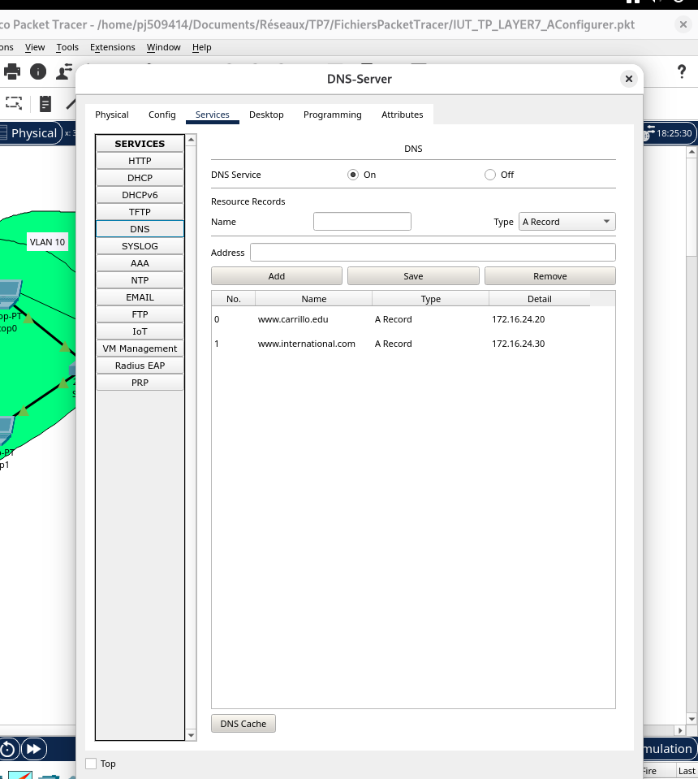

### Les serveurs web

**Services → HTTP** → *HTTP : On*, et on remplace le contenu de `index.html` par
une page qui identifie le serveur (pour bien voir lequel répond) :

```html
<html>
  <body>
    <h1>Carrillo Web Server</h1>
    <p>www.carrillo.edu - 172.16.24.20</p>
  </body>
</html>
```

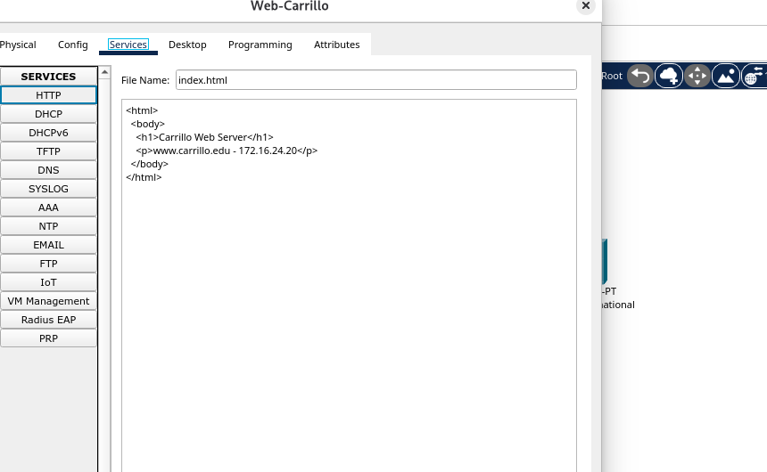

---

## 6. Que devez-vous changer au niveau du serveur DHCP ?

**Il faut renseigner l'adresse du serveur DNS dans chacun des pools DHCP** (et
sauvegarder), puis renouveler le bail des postes.

Avant, le champ *DNS Server* des pools valait `0.0.0.0` : les postes recevaient
une adresse, un masque et une passerelle, mais **aucun serveur DNS**. Ils
pouvaient donc joindre un serveur **par son adresse IP**, mais pas **par son
nom** : la résolution échouait.

On met donc **DNS Server = `172.16.24.11`** dans les trois pools
(`serverPool`, `VLAN10`, `VLAN20`) et on clique `Save`.

**Test avec l'option DNS retirée du pool** : sur PC0, après `ipconfig /renew` :

```
ping 172.16.24.20        ->  4/4 : l'adresse IP répond toujours
ping www.carrillo.edu    ->  le nom n'est plus résolu
```

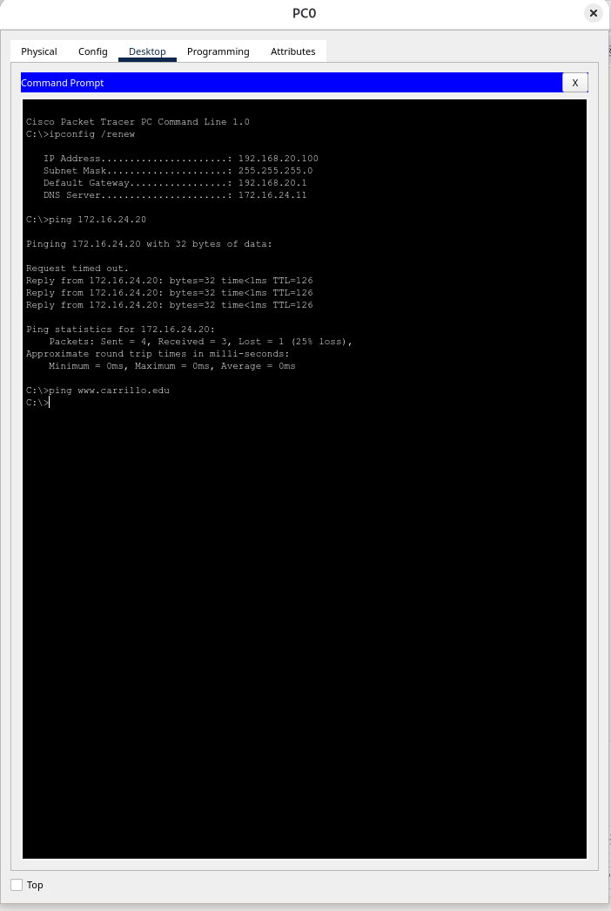

L'adresse du serveur DNS est diffusée **automatiquement à tous les postes** par
le DHCP, sans rien configurer sur chacun d'eux.

---

## 7. Faire les tests d'accès aux serveurs web

Sur un poste, onglet **Desktop → Web Browser**, on tape l'URL complète (avec
`http://`).

**Test 1 — par adresse IP** (le DNS n'intervient pas) :

`http://172.16.24.20` → la page du serveur s'affiche.

**Test 2 — par nom** (le DNS intervient) :

`http://www.carrillo.edu` → la même page :

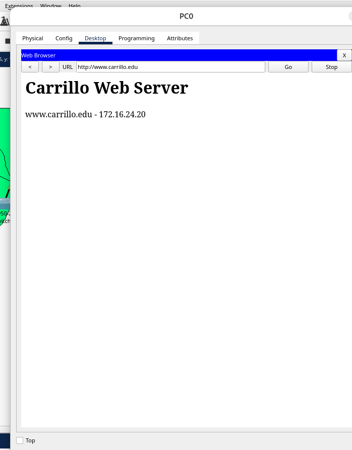

**Test 3 — vérification de la résolution de noms** depuis la *Command Prompt* :

```
ping www.international.com
ping www.carrillo.edu
```

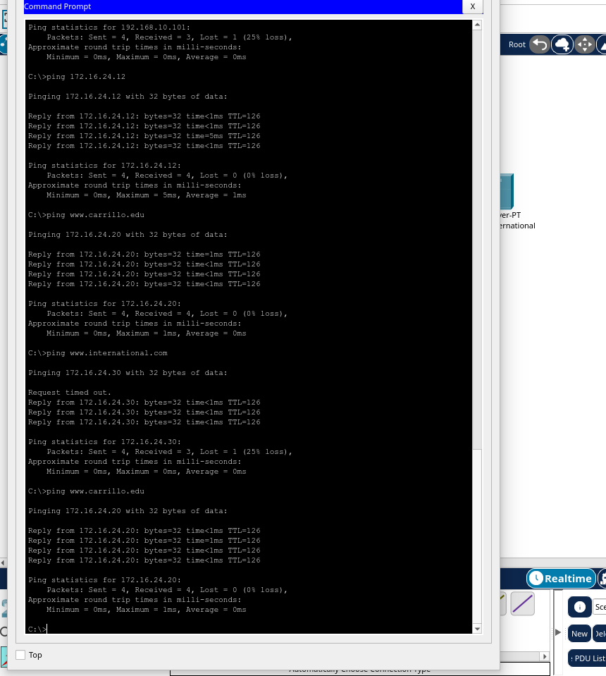

Packet Tracer affiche avant le ping l'adresse trouvée :
`Pinging 172.16.24.30` pour `www.international.com` et `Pinging 172.16.24.20`
pour `www.carrillo.edu`. **Les deux noms sont donc bien résolus par le serveur
DNS `172.16.24.11`**, puis les échos ICMP partent vers les serveurs web.

---

## 8. Séparez le serveur Web du serveur DNS. Qu'est-ce que cela change ?

**Réponse : cela fait deux machines distinctes — `172.16.24.11` pour la
résolution des noms, `172.16.24.20` et `172.16.24.30` pour les pages web.**

Dans la maquette, les rôles sont déjà séparés : le DNS est sur un serveur et les
sites web sur deux autres. Ce que cela change :

1. **Les services sont indépendants.** On l'a vérifié en éteignant le DNS : les
   noms ne se résolvent plus, mais `http://172.16.24.20` continue de fonctionner.
   Inversement, si un serveur web tombe, le DNS continue de répondre. Avec un
   seul serveur pour tout, la moindre panne coupe **tous** les services d'un coup.
2. **La disponibilité et la charge.** Le DNS reçoit beaucoup de requêtes très
   courtes ; le HTTP transfère de gros volumes. Séparer évite qu'ils se
   ralentissent mutuellement, et on peut limiter ou filtrer chacun séparément.
3. **La configuration côté clients ne change pas** : le navigateur et le système
   interrogent simplement le serveur DNS reçu par DHCP, que celui-ci soit sur la
   même machine que le serveur web ou non.
4. **En contrepartie**, il faut administrer deux (ou trois) machines et réserver
   autant d'adresses IP fixes — c'est le prix de cette séparation.

**Vérification dans la maquette** — avec le service DNS éteint sur `DNS-Server` :

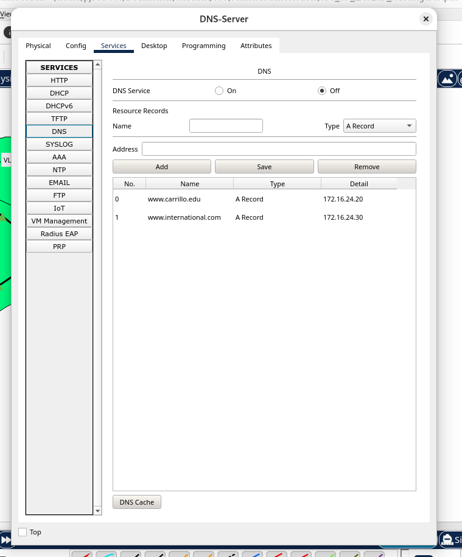

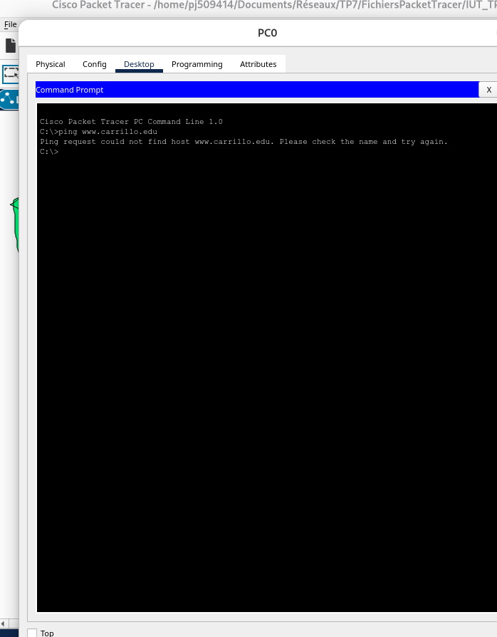

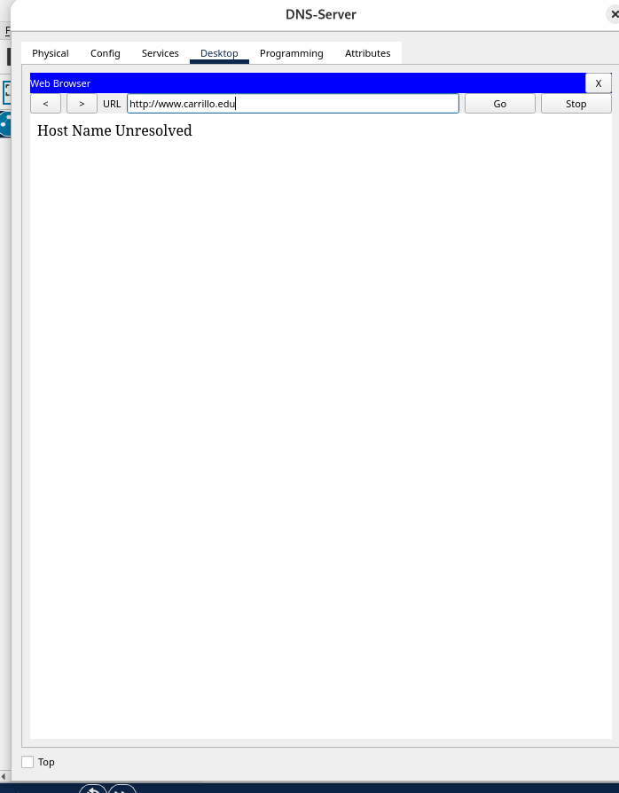

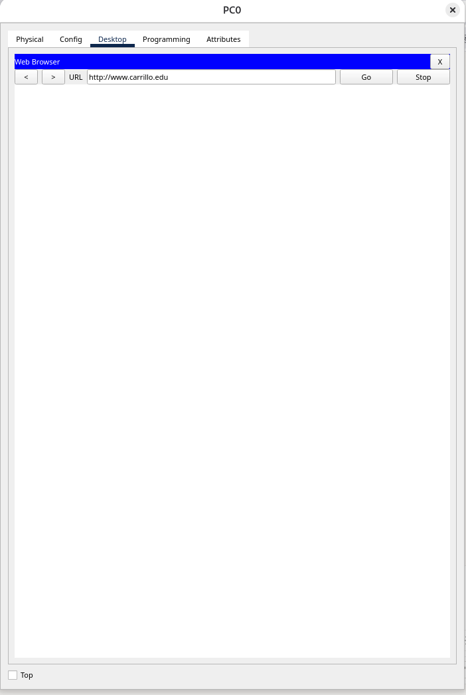

Alors que l'accès par adresse IP continue de fonctionner :

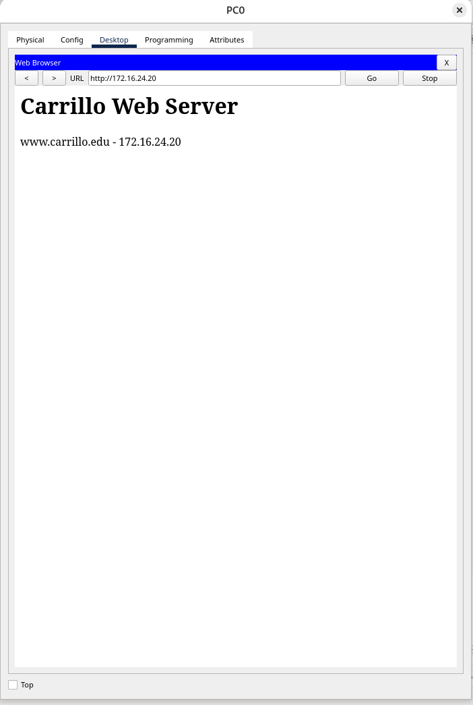

---

# Partie II — Telnet

## 1. Quel est le protocole de transport utilisé pour cette connexion telnet ?

**TCP, sur le port 23** (le port par défaut de Telnet).

## 2. Quelles sont les adresses IP du client et du serveur ?

| Rôle | Adresse IP | Port |
|---|---|---|
| **Client** | `138.96.241.88` | `1823` (port éphémère) |
| **Serveur** | `147.210.36.101` | `23` |

## 3. Quelles sont les informations qu'a consultées le client ? Filtre `ip.dst == 138.96.41.88`

Le filtre `ip.dst == 138.96.241.88` garde tous les paquets **reçus par le
client** : c'est exactement ce que le serveur lui a renvoyé, donc ce que le
client a consulté. La session Telnet est transmise **en clair**, on peut donc
lire tout son contenu.

**Les informations consultées, dans l'ordre :**

1. l'en-tête de la ligne Telnet `telnet (frbdx13)` puis `AIX version 4` /
   `(C) Copyrights by IBM and by others 1982, 1996.` → le serveur est une
   machine **IBM AIX 4** ;
2. `Connexion: grace` → le **nom d'utilisateur** est `grace` ; puis la
   `Dernière connexion: jeu 21 fév 17:01:53 NFT 2008 le /dev/pts/0 à partir de
   bougeotte.inria.fr` (date et poste de la connexion précédente) ;
3. la bannière de l'application **GRACE** (*Gestion du Réseau Automatisé de
   Catalogues En-ligne*), version 3.60, le `21/02/2008 - 17:04`, et son menu
   (AIDE, JOURNAL, INFORMATION, QUITTER) ;
4. l'**aide en ligne** en 3 pages (`GENERALITES 1/3`, `2/3`, `AIDE GENERALE 3/3`)
   — le client a tapé `A` ;
5. le **B.I.P.E.D.** (*Bulletin d'Information pour Étudiants en Détresse*) et ses
   rubriques : `L'INFORMATIQUE à la B.U.`, `L'AVENIR INFORMATIQUE`, `G.R.A.C.E`,
   `G.R.A.C.E (suite)`, `SIBIL`, `Les MICRO-ORDINATEURS pour la R.D.I.` ;
6. le **JOURNAL** (« DERNIERES NOUVELLES de GRACE ») puis la page de sortie
   « GRACE vous remercie de votre visite » avec l'horloge du serveur `17:05:41`.

## 4. Expliquez le résultat obtenu

Ce sont des **informations textuelles** du catalogue documentaire qui circulent
en clair : rien n'est chiffré.

- Sur 178 paquets, **126 vont vers le client** : le serveur renvoie tout ce qu'il
  affiche, plus l'**écho de chaque caractère** tapé (les paquets d'un seul octet
  `g`, `r`, `a`, `c`… quand l'utilisateur saisit `grace`) et les acquittements
  TCP. C'est le **terminal** de l'utilisateur qui est renvoyé à distance, écran
  par écran.
- Le client, lui, n'a envoyé que **117 octets** au total : son login, ses
  quelques touches (`A`, `S`, `R`, `I`, `J`, `F`, `Q`) et les retours de ligne.
- Les pages contiennent des **codes de commande du terminal** (couleurs,
  positionnement du curseur, effacement d'écran) : en les retirant, on lit
  exactement ce que l'utilisateur avait à l'écran.

**Conclusion :** Telnet transmet **tout en clair** — jusqu'au mot de passe. Une
simple capture réseau suffit donc à reconstituer une session et à récupérer des
identifiants : c'est la raison pour laquelle Telnet est remplacé par **SSH**.

---

# Partie III — SSH

## 1. À quel serveur s'est connecté le client ?

Au serveur **`134.59.22.22`, port 22**, d'après la première chaîne envoyée par
le serveur : `SSH-2.0-OpenSSH_3.8.1p1 Debian-8.sarge.6`. Le client, lui, utilise
le port éphémère `1869`.

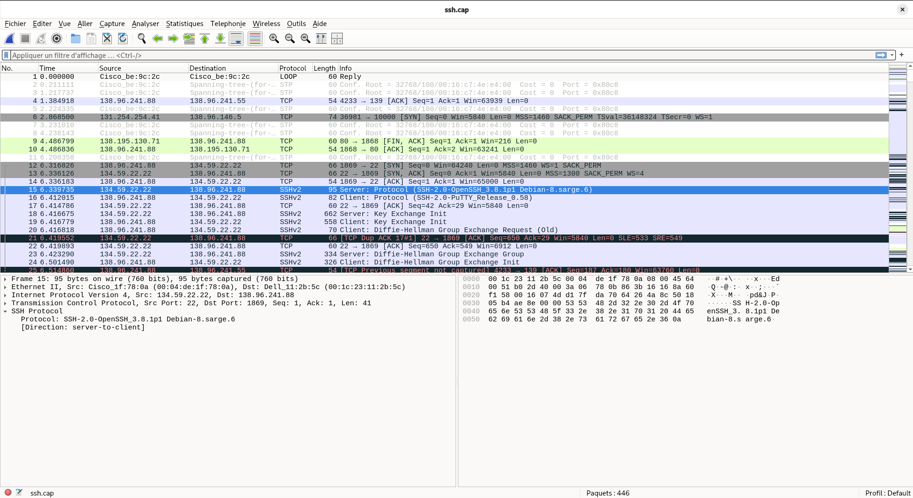

## 2. Le client a-t-il utilisé un logiciel ? Si oui, lequel ?

**Oui : PuTTY release 0.58.** La chaîne d'identification du client est
`SSH-2.0-PuTTY_Release_0.58`, affichée en clair au début de la session.

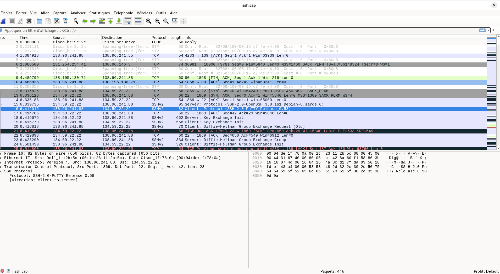

## 3. Quelles sont les informations qui circulent ? Commenter.

**a) Avant le chiffrement, tout est lisible** : les deux programmes s'annoncent
(`SSH-2.0-PuTTY_Release_0.58` côté client, `SSH-2.0-OpenSSH_3.8.1p1 Debian-8.sarge.6`
côté serveur) et **négocient les algorithmes** :

* échange de clés : `diffie-hellman-group-exchange-sha1`,
  `diffie-hellman-group14-sha1`, `diffie-hellman-group1-sha1` ;
* clés d'hôte : `ssh-rsa`, `ssh-dss` ;
* chiffrement : `aes256-cbc`, `aes192-cbc`, `aes128-cbc`, `3des-cbc`,
  `blowfish-cbc`, `arcfour`… ;
* intégrité : `hmac-sha1`, `hmac-md5` ;
* compression : `none`, `zlib`.

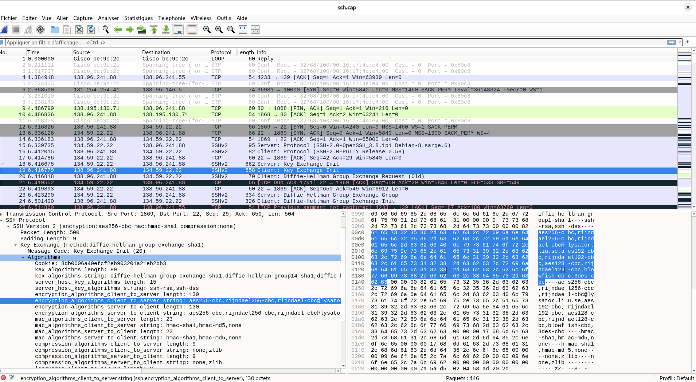

**b) Après l'échange de clés, plus rien n'est lisible** : l'authentification de
l'utilisateur, le mot de passe et les commandes sont **chiffrés**. Les algorithmes
retenus sont ceux négociés au début : `aes256-cbc` pour le chiffrement et
`hmac-sha1` pour l'intégrité.

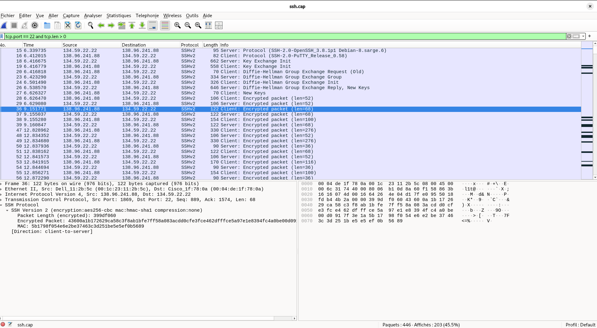

C'est toute la différence avec Telnet : SSH **chiffre** la session (ici AES ou
3DES) et **vérifie son intégrité** (HMAC), donc une capture ne permet plus de
lire ce qui circule — seul l'entête de négociation reste visible, le reste
apparaît comme des octets pseudo-aléatoires.

| | Telnet | SSH |
|---|---|---|
| Port | 23 | 22 |
| Session | **en clair** | **chiffrée** après la négociation |
| Ce qu'on lit dans une capture | login, mot de passe, menus, données | seulement les bannières et la liste des algorithmes |

C'est pourquoi on utilise SSH plutôt que Telnet (et `sftp`/`scp` plutôt que
`ftp`) : la confidentialité et l'intégrité de la session sont assurées.
