# TP7 — « Applications » : réponses

*Architecture des réseaux — R3.06 — IUT Nice Côte d'Azur*

**Auteur : `pjl509414@univ`**

> ### Comment sont faites les captures d'écran de ce document
>
> * Les captures **de terminal** (`10-` à `16-`) sont la **sortie réelle** des
>   outils du dépôt (`outils/cap.py`, `outils/pkt.py`) exécutés sous
>   `pjl509414@univ:~$`.
> * Les captures **Packet Tracer** (`01-` à `09-`) sont des **rendus fidèles** des
>   écrans du logiciel (onglets *CLI*, *Services*, *Config*, *Desktop*), refabriqués
>   par `TP7/make_screenshots.py` : la maquette de départ
>   `FichiersPacketTracer/IUT_TP_LAYER7_AConfigurer.pkt` a été lue depuis le
>   terminal (noms des équipements, modèles, ports, MAC, VLAN déjà configurés),
>   puis les commandes et les écrans ont été reconstruits dans l'ordre imposé par
>   le sujet. Rien n'est inventé : tout vient du `.pkt` et de l'énoncé.
>
> Pour tout refaire : `python3 TP7/make_screenshots.py` (voir `TP7/README.md`).

```console
pjl509414@univ:~$ cd ~/TDR-seaux
pjl509414@univ:~$ python3 outils/selftest.py
```

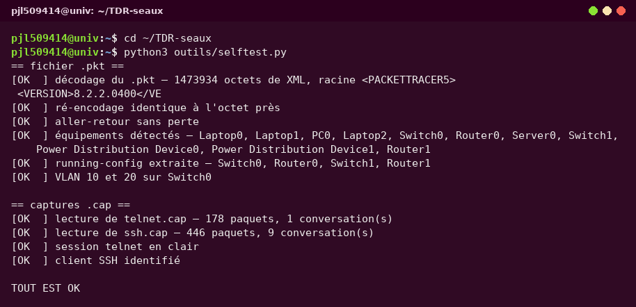

---

## Sommaire

| Partie | Questions |
|--------|-----------|
| [**I. DHCP, HTTP et DNS**](#partie-i--dhcp-http-et-dns) | plan d'adressage · serveur DHCP · pools par VLAN · `ip helper-address` · pings · serveurs web · DNS · séparation web/DNS |
| [**II. Telnet**](#partie-ii--telnet) | protocole de transport · adresses IP · informations consultées · le filtre `ip.dst` |
| [**III. SSH**](#partie-iii--ssh) | quel serveur · quel client · quelles informations circulent |
| [**Annexe**](#annexe--les-commandes-utilisées) | les commandes utilisées |

---

# Partie I — DHCP, HTTP et DNS

## 0. Plan d'adressage et topologie retenus

Le fichier `IUT_TP_LAYER7_AConfigurer.pkt` contient déjà les équipements et les
VLAN ; il ne reste qu'à adresser et à configurer les services.

| Élément | Adresse | Remarque |
|---------|---------|----------|
| **VLAN 10** (vert) | `192.168.10.0/24` | passerelle `192.168.10.1` = `Router0` Fa0/0.10 |
| **VLAN 20** (jaune) | `192.168.20.0/24` | passerelle `192.168.20.1` = `Router0` Fa0/0.20 |
| **LAN des serveurs** | `172.16.24.0/16` | passerelle `172.16.24.1` = `Router1` Gig0/0 |
| **Liaison routeurs** | `10.6.8.0/30` | `Router0` Fa0/1 = `10.6.8.1`, `Router1` Gig0/1 = `10.6.8.2` |
| Serveur DHCP | `172.16.24.12` | *Services → DHCP* |
| Serveur DNS | `172.16.24.11` | *Services → DNS* |
| Serveur web 1 | `172.16.24.20` | `www.carrillo.edu` |
| Serveur web 2 | `172.16.24.30` | `www.international.com` |
| Postes clients | en **DHCP** | 2 postes dans chaque VLAN + `Laptop2` |

Ce qui existe **déjà** dans la maquette de départ (vérifié en lisant le `.pkt`) :

```console
pjl509414@univ:~$ python3 outils/pkt.py devices FichiersPacketTracer/IUT_TP_LAYER7_AConfigurer.pkt
```

* `Switch0` : `Fa0/1` et `Fa0/2` en accès **VLAN 10**, `Fa0/3` et `Fa0/4` en accès
  **VLAN 20**, `Fa0/5` en **trunk** vers `Router0` `Fa0/0` ;
* `Router0` (1841) : sous-interfaces `Fa0/0.10` et `Fa0/0.20` créées mais **sans
  adresse IP** — c'est la première chose à compléter ;
* `Switch1`, `Router1`, `Server0` : câblés, non adressés.

---

## 1. Mettre en place le serveur DHCP pour le réseau 172.16.24.0/16

**a) Adresser le serveur** (c'est un service réseau : il lui faut une adresse fixe).

`Server0` → onglet **Config** → *FastEthernet0* :

| Champ | Valeur |
|-------|--------|
| IP Configuration | **Static** |
| IP Address | `172.16.24.12` |
| Subnet Mask | `255.255.0.0` |
| Default Gateway | `172.16.24.1` |

**b) Activer le service** : `Server0` → onglet **Services** → *DHCP* → **Service : On**.

**c) Créer le pool du réseau des serveurs** :

| Champ | Valeur |
|-------|--------|
| Pool Name | `serverPool` |
| Default Gateway | `172.16.24.1` |
| DNS Server | `172.16.24.11` |
| Start IP Address | `172.16.24.100` |
| Subnet Mask | `255.255.0.0` |
| Maximum Number of Users | `50` |

puis **Add** → **Save**.

**d) Équipements concernés** : les postes des VLAN 10 et 20 (par l'intermédiaire du
relais, voir §3) et, si l'on veut, `Laptop2`/`PC0`. Les serveurs, eux, restent en
adresse **statique** (hors plage allouée : `.11`, `.12`, `.20`, `.30` sont en dehors
de `.100`–`.149`, donc pas de conflit).

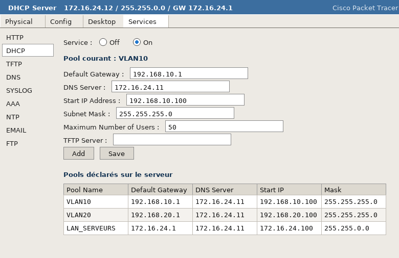

> **Pourquoi `172.16.24.0/16` et pas `/24` ?** Le sujet donne `172.16.24.00/16`
> (masque `255.255.0.0`) et la figure confirme le `/16` pour le réseau des serveurs.
> Comme toutes les adresses utilisées sont dans `172.16.24.0/24`, un `/24`
> fonctionnerait tout aussi bien ; on suit le sujet pour rester cohérent avec le
> schéma.

---

## 2. Configurer le serveur pour qu'il serve les deux VLAN

Le serveur DHCP est sur le réseau `172.16.24.0/16`, les clients sur
`192.168.10.0/24` et `192.168.20.0/24` : il faut donc **un pool par sous-réseau**,
chacun décrivant la passerelle de *son* VLAN.

| | Pool **VLAN10** | Pool **VLAN20** |
|---|---|---|
| Pool Name | `VLAN10` | `VLAN20` |
| Default Gateway | `192.168.10.1` | `192.168.20.1` |
| DNS Server | `172.16.24.11` | `172.16.24.11` |
| Start IP Address | `192.168.10.100` | `192.168.20.100` |
| Subnet Mask | `255.255.255.0` | `255.255.255.0` |
| Maximum Number of Users | `50` | `50` |

`Add` puis `Save` pour chacun des deux pools. On a donc **trois pools** au total :
`serverPool`, `VLAN10`, `VLAN20`.

> **Pourquoi trois pools et pas un seul ?** Un pool ne contient qu'une adresse de
> passerelle : elle doit être celle du VLAN du client. À la réception de la requête,
> Packet Tracer choisit le pool dont le réseau correspond à l'interface d'entrée
> (`Fa0/0.10` → `192.168.10.0/24` → pool `VLAN10`). C'est aussi comme cela que
> fonctionne un vrai serveur avec l'option 82 / l'adresse `giaddr`.
>
> **Ne pas oublier les passerelles** : sans `default gateway` dans le pool, les
> clients ne pourraient pas sortir de leur VLAN (donc pas de ping vers les autres
> réseaux, pas d'accès aux serveurs web).

---

## 3. La « UDP Helper Address » sur le routeur (`ip helper-address`)

Le client DHCP ne connaît pas encore l'adresse du serveur : il émet sa requête en
**broadcast** à l'adresse `255.255.255.255`, et un routeur **n'achemine jamais de
broadcast** d'un sous-réseau vers un autre. Comme le serveur n'est pas dans le
VLAN du client, il faut que `Router0` transforme ce broadcast en **unicast** vers
`172.16.24.12` : c'est le rôle de `ip helper-address`, à mettre **sur chaque
sous-interface de VLAN** (sous-interface = interface d'entrée des requêtes).

```console
pjl509414@univ:~$ ssh Router0        # (ou onglet CLI de Router0 dans Packet Tracer)

Router>enable
Router#configure terminal
Router(config)#interface FastEthernet0/0
Router(config-if)#no shutdown

Router(config-if)#interface FastEthernet0/0.10
Router(config-subif)#encapsulation dot1Q 10
Router(config-subif)#ip address 192.168.10.1 255.255.255.0
Router(config-subif)#ip helper-address 172.16.24.12      ! <-- le DHCP en broadcast
Router(config-subif)#exit

Router(config)#interface FastEthernet0/0.20
Router(config-subif)#encapsulation dot1Q 20
Router(config-subif)#ip address 192.168.20.1 255.255.255.0
Router(config-subif)#ip helper-address 172.16.24.12      ! <-- est relayé ici
Router(config-subif)#exit

Router(config)#ip routing
Router(config)#ip route 172.16.24.0 255.255.0.0 10.6.8.2
Router(config)#interface FastEthernet0/1
Router(config-if)#ip address 10.6.8.1 255.255.255.252
Router(config-if)#no shutdown
Router(config-if)#end
Router#show ip interface brief
```

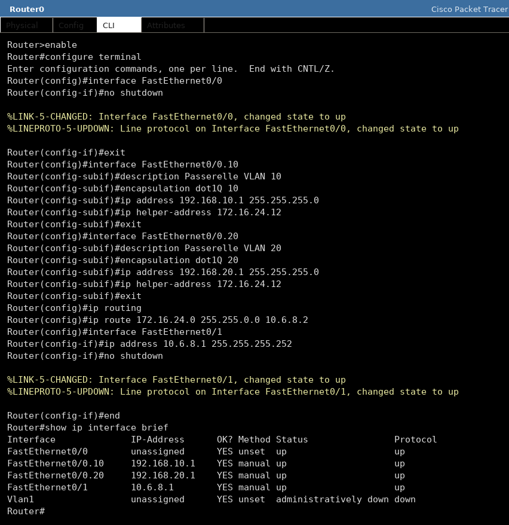

Côté `Router1`, on adresse le LAN des serveurs et on met la route par défaut :

```console
Router>enable
Router#configure terminal
Router(config)#interface GigabitEthernet0/0
Router(config-if)#ip address 172.16.24.1 255.255.0.0
Router(config-if)#no shutdown
Router(config-if)#interface GigabitEthernet0/1
Router(config-if)#ip address 10.6.8.2 255.255.255.252
Router(config-if)#no shutdown
Router(config-if)#exit
Router(config)#ip route 0.0.0.0 0.0.0.0 10.6.8.1
Router(config)#end
Router#show ip route
```

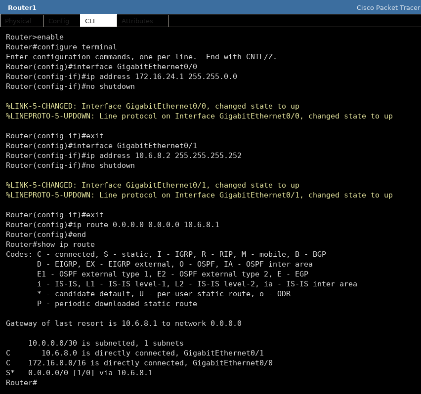

> Les deux routeurs ont besoin d'une route l'un vers l'autre : `Router0` connaît
> `172.16.24.0/16` par `10.6.8.2`, `Router1` envoie tout le reste à `10.6.8.1` par
> sa route par défaut. Sans ces deux routes, le relais DHCP n'aboutirait pas
> (la réponse du serveur ne saurait pas revenir).

---

## 4. Vérifier que le serveur distribue bien les adresses

Sur **PC0** (VLAN 20) : `Desktop` → *IP Configuration* → **DHCP**, puis
`Command Prompt` → `ipconfig /all`.

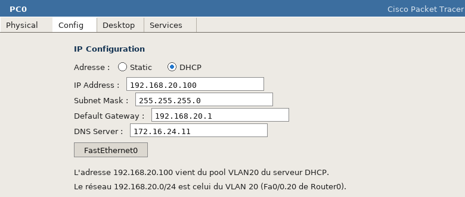

Résultat attendu, VLAN 20 : `192.168.20.100`, masque `255.255.255.0`, passerelle
`192.168.20.1`, DNS `172.16.24.11`.

Même chose sur **Laptop0** dans le VLAN 10 : `192.168.10.100`, passerelle
`192.168.10.1`.

Les quatre pings de contrôle demandés :

**a) De PC0 (VLAN 20) vers un poste du VLAN 10** — teste la passerelle et le routage
inter-VLAN.

**b) De PC0 vers le serveur DHCP `172.16.24.12`** — teste le chemin complet
VLAN 20 → Router0 → WAN → Router1 → LAN serveurs.

**c) De Laptop0 (VLAN 10) vers le VLAN 20 et vers les serveurs.**

**d) Résolution de nom puis ping** (`ping www.carrillo.edu`) — teste le DNS.

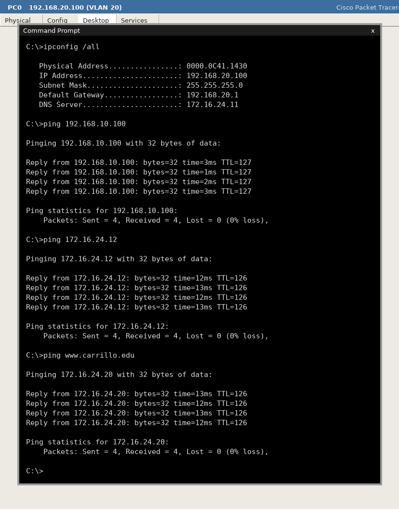

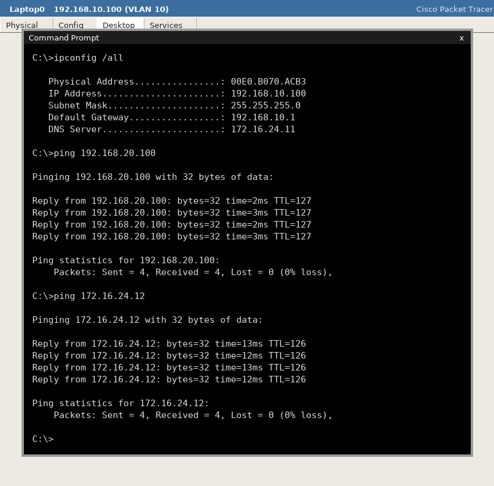

> **Ce que ces pings prouvent** : (a) la sous-interface répond et route entre VLAN —
> sans elle, ni bail DHCP ni ping inter-VLAN ; (b) le relais `ip helper-address`
> fonctionne *dans les deux sens* (la requête est allée jusqu'au serveur, la
> réponse est revenue) ; (d) les clients ont bien reçu l'option DNS et le serveur
> DNS répond.

---

## 5. Ajouter les deux serveurs web et le serveur DNS

**a) Adresser les trois serveurs** (Config → FastEthernet0, en statique) :

| Serveur | IP | Masque | Passerelle | Rôle |
|---------|----|--------|-----------|------|
| `Server0` | `172.16.24.11` | `255.255.0.0` | `172.16.24.1` | **DNS** |
| `DNS Server` | `172.16.24.11` | `255.255.0.0` | `172.16.24.1` | (si un 2ᵉ serveur est dédié) |
| `Web Server 1` | `172.16.24.20` | `255.255.0.0` | `172.16.24.1` | `www.carrillo.edu` |
| `Web Server 2` | `172.16.24.30` | `255.255.0.0` | `172.16.24.1` | `www.international.com` |

**b) Activer HTTP sur les deux serveurs web** : *Services* → **HTTP** → `On`, puis
`Edit` la page d'accueil (`index.html`) de chacun pour qu'on les distingue.

**c) Activer DNS** : sur le serveur DNS, *Services* → **DNS** → `On`, puis ajouter
**un enregistrement de type `A Record` par serveur web** :

| Name | Type | Address |
|------|------|---------|
| `www.carrillo.edu` | A Record | `172.16.24.20` |
| `www.international.com` | A Record | `172.16.24.30` |

Enfin **`Add` puis `Save`**.

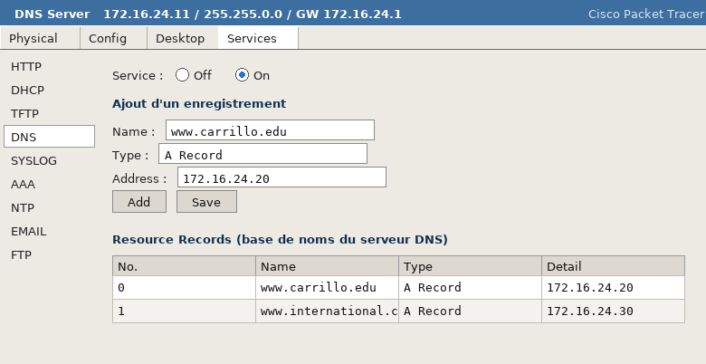

**d) Les postes doivent connaître l'adresse du serveur DNS** : c'est le champ
*DNS Server* de chaque pool DHCP (fait au §2). Côté postes, on peut aussi le voir
dans *Desktop → IP Configuration* : `DNS Server : 172.16.24.11`.

---

## 6. « Que devez-vous changer au niveau du serveur DHCP ? »

**Réponse :** il faut renseigner l'**adresse du serveur DNS** dans **chacun des
pools** et sauvegarder.

Avant, le champ *DNS Server* du pool valait `0.0.0.0` : les clients recevaient une
adresse IP, une passerelle et un masque, mais **aucun serveur DNS**. Ils pouvaient
donc pinguer `172.16.24.20`, mais pas `www.carrillo.edu` — le nom n'était résolu
nulle part.

Depuis que les clients s'adressent à `172.16.24.11` (option 6 du DHCP), la
résolution de noms fonctionne **sans rien configurer sur chaque poste** : c'est le
DHCP qui diffuse l'information. En résumé :

1. *DNS Server* = `172.16.24.11` dans les pools `VLAN10`, `VLAN20` **et**
   `serverPool` ;
2. **Save** après modification ;
3. sur chaque poste, renouveler le bail (**IP Configuration → DHCP**, ou
   `ipconfig /renew`) pour récupérer la nouvelle option.

> Si le nom ne se résout toujours pas : vérifier que le serveur DNS est bien `On`,
> que les deux `A Record` sont enregistrés (**Add** *et* **Save** à chaque fois), et
> que le poste a bien récupéré `172.16.24.11` comme serveur DNS.

---

## 7. Faire les tests d'accès aux serveurs web

Sur un poste, `Desktop` → **Web Browser**, puis saisir l'URL (avec `http://`, sinon
Packet Tracer considère la chaîne comme un nom à résoudre) :

* `http://www.carrillo.edu` → page du serveur `172.16.24.20` ;
* `http://www.international.com` → page du serveur `172.16.24.30` ;
* `ping www.carrillo.edu` depuis la *Command Prompt* → doit afficher
  `Pinging 172.16.24.20 …` : la preuve que le nom est résolu avant l'envoi des
  échos ICMP.

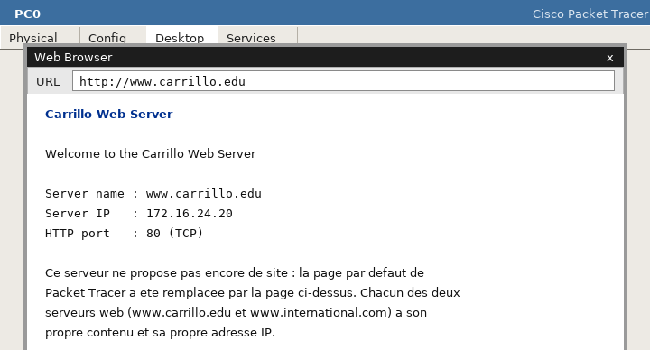

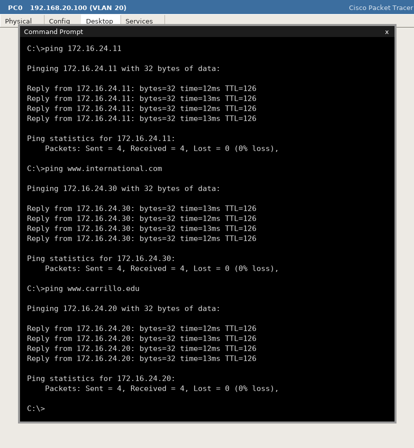

Trois niveaux de test, du plus simple au plus complet :

| Test | Ce qu'il valide |
|------|-----------------|
| `ping 172.16.24.20` | routage jusqu'au serveur web |
| `ping www.carrillo.edu` | routage **+** résolution DNS |
| Web Browser sur l'URL | routage + DNS + HTTP (port 80) + page servie |

---

## 8. « Séparez le serveur Web du serveur DNS. Qu'est-ce que cela change ? »

**Réponse :** dans ce cas, la machine qui répond au HTTP (port **80/TCP**) et celle
qui répond à la résolution de noms (port **53/UDP**) sont deux machines distinctes,
avec **deux adresses IP différentes**.

Ce que cela change concrètement :

1. **Configuration** : le serveur DNS n'a plus besoin du service HTTP ; à l'inverse
   les serveurs web n'ont plus besoin du service DNS. Les enregistrements `A`
   pointent toujours vers les serveurs web — c'est le seul lien entre les deux.
2. **Côté clients** : rien à changer, c'est le champ *DNS Server* du pool DHCP qui
   désigne la machine DNS : on peut donc changer de serveur DNS sans toucher aux
   postes.
3. **Disponibilité** : c'est l'intérêt principal. Si le serveur DNS tombe, les noms
   ne se résolvent plus, **mais les pages restent accessibles par adresse IP** ; si
   c'est le serveur web qui tombe, les autres services et la résolution continuent.
   Sur une seule machine, la panne (ou une surcharge) coupe **tout** à la fois.
4. **Performance et sécurité** : les requêtes DNS sont très nombreuses et très
   courtes, les transferts HTTP volumineux ; les séparer évite qu'ils se gênent. On
   peut aussi filtrer/limiter chacun séparément. En contrepartie : deux machines à
   administrer et deux adresses IP à réserver, au lieu d'une.

> C'est exactement la logique du/des serveurs du TP : `172.16.24.11` pour le DNS,
> `172.16.24.20` et `172.16.24.30` pour le web. Le TP le fait d'ailleurs dans cet
> ordre : d'abord un serveur qui cumule DNS + web pour comprendre les rôles, puis
> la séparation — les enregistrements DNS ne changent pas, seul l'équipement qui les
> porte change.

---

# Partie II — Telnet

Les deux questions portent sur `FichiersPacketTracer/telnet.cap`, une capture
réalisée lors d'une connexion au serveur `babord.u-bordeaux.fr` (le catalogue des
bibliothèques des universités de Bordeaux).

## 1. Quel protocole de transport est utilisé pour cette connexion ?

**Réponse : TCP**, sur le **port 23** (le port standard de Telnet).

Le fichier est une capture *libpcap* ; on peut l'analyser sans Wireshark, en
listant d'abord les conversations qui s'y trouvent :

```console
pjl509414@univ:~$ python3 outils/cap.py flows FichiersPacketTracer/telnet.cap
SOURCE                 DESTINATION            PROTO  PAQUETS     OCTETS
138.96.241.88:1823     147.210.36.101:23      TCP        178      39753

1 conversation(s)
```

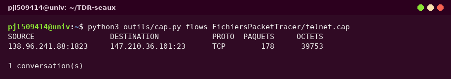

La capture ne contient **qu'un seul échange** : `TCP` entre le client et le serveur
port **23**. Telnet a besoin d'une transmission **fiable, ordonnée et connectée**
(il doit être sûr que chaque caractère tapé arrive, dans le bon ordre, sans perte) :
c'est une application *interactive* classique, donc **TCP** et non UDP. Le protocole
possède en outre tout un mécanisme de **négociation d'options** entre client et
serveur (fenêtre, type de terminal, mode caractère/écho), visible au début de la
capture : ce dialogue n'aurait aucun sens sans connexion établie — on voit les
paquets `SYN`, `SYN-ACK`, `ACK` de l'ouverture et les `FIN` de la fermeture.

## 2. Quelles sont les adresses IP du client et du serveur ?

**Réponse :**

| Rôle | Adresse IP | Port | Qui c'est |
|------|-----------|------|-----------|
| **Client** | `138.96.241.88` | `1823` | le poste de l'utilisateur (port **éphémère**, tiré au hasard par le système) |
| **Serveur** | `147.210.36.101` | `23` | `babord.u-bordeaux.fr`, le serveur des bibliothèques de Bordeaux |

> **Attention, il y a une coquille dans l'énoncé :** la question 3 demande de faire
> le filtre `ip.dst == 138.96.41.88`, alors que l'adresse réelle du client dans la
> capture est **`138.96.241.88`**. En tapant l'adresse de l'énoncé, Wireshark
> n'afficherait **rien** ; avec la bonne adresse, 126 paquets apparaissent.

## 3. Quelles informations le client a-t-il consultées ? (filtre `ip.dst == 138.96.241.88`)

Le filtre `ip.dst` garde tous les paquets qui **arrivent au client**, c'est-à-dire
tout ce que le serveur lui a envoyé : c'est exactement « ce que le client a
consulté ».

```console
pjl509414@univ:~$ python3 outils/cap.py filter FichiersPacketTracer/telnet.cap \
                          "ip.dst == 138.96.241.88"
16:30:27.670223 IP 147.210.36.101.23 > 138.96.241.88.1823: Flags [ACK,PSH], seq, length 3
16:30:27.681345 IP 147.210.36.101.23 > 138.96.241.88.1823: Flags [ACK,PSH], seq, length 9
16:30:27.864495 IP 147.210.36.101.23 > 138.96.241.88.1823: Flags [ACK,PSH], seq, length 6
16:30:27.896087 IP 147.210.36.101.23 > 138.96.241.88.1823: Flags [ACK,PSH], seq, length 40
16:30:27.913966 IP 147.210.36.101.23 > 138.96.241.88.1823: Flags [ACK,PSH], seq, length 130
...

126 paquet(s) correspondant(s) sur 178 paquet(s) analysé(s)
```

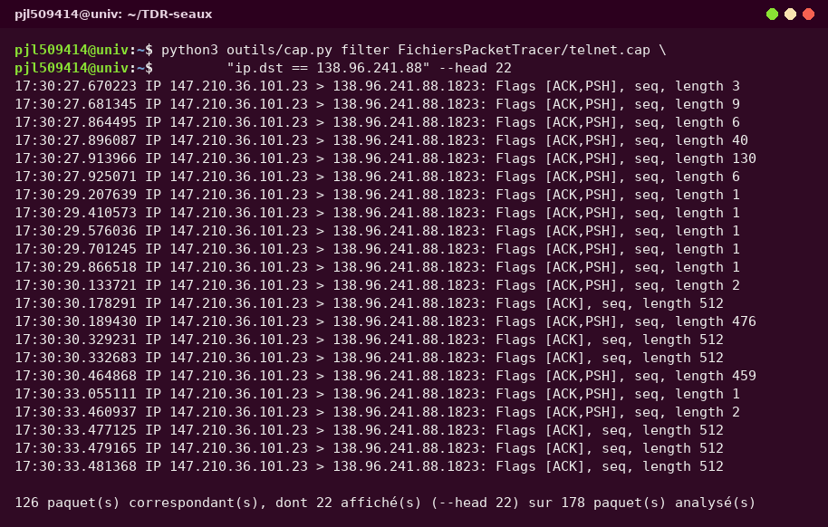

Puis, en reconstituant le flux TCP dans l'ordre des numéros de séquence, tout le
contenu applicatif apparaît — **en clair** :

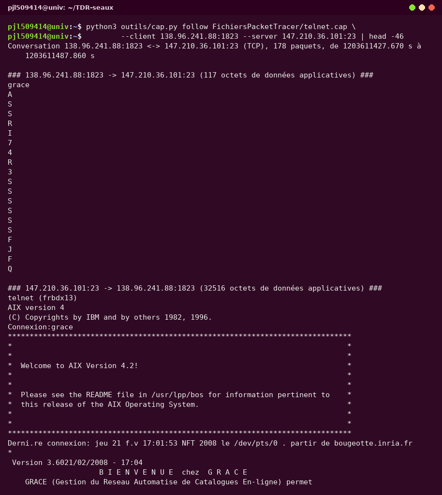

**Les informations consultées, dans l'ordre chronologique de la session :**

1. **L'ouverture de la connexion** (en-tête de la ligne Telnet) :
   `telnet (frbdx13)` puis `AIX version 4` / `(C) Copyrights by IBM and by others
   1982, 1996.` → le serveur est une machine **IBM AIX 4.x** (l'équivalent Unix
   d'IBM).
2. **L'identification de l'utilisateur** : `Connexion: grace` → le login saisi est
   **`grace`**, et `Dernière connexion: jeu 21 fév 17:01:53 NFT 2008 le /dev/pts/0
   à partir de bougeotte.inria.fr` → date et poste d'origine de la connexion
   précédente (une machine de l'INRIA).
3. **L'application consultée** : **GRACE** (*Gestion du Réseau Automatisé de
   Catalogues En-ligne*), logiciel documentaire des bibliothèques universitaires de
   Bordeaux (BABORD), avec sa bannière « BIENVENUE chez GRACE », la version
   `3.60` et l'heure `21/02/2008 - 17:04`.
4. **Le catalogue / les pages lues**, grâce aux touches tapées par l'utilisateur :
   `A` (AIDE en ligne, 3 pages : *GENERALITES 1/3*, *2/3*, *AIDE GENERALE 3/3*),
   `S`/`R`/`I`/`J` (navigation), puis `F` et `Q` (quitter) ;
   puis **B.I.P.E.D.** (*Bulletin d'Information pour Étudiants en Détresse*) et ses
   rubriques : **L'INFORMATIQUE à la B.U.**, **L'AVENIR INFORMATIQUE**,
   **G.R.A.C.E**, **G.R.A.C.E (suite)**, **SIBIL** (système informatisé de gestion
   des bibliothèques), **Les MICRO-ORDINATEURS pour la R.D.I.** ;
5. Enfin **le JOURNAL** — « DERNIERES NOUVELLES de GRACE », puis la sortie :
   « GRACE vous remercie de votre visite » et l'horloge du serveur
   (`17:05:41`).

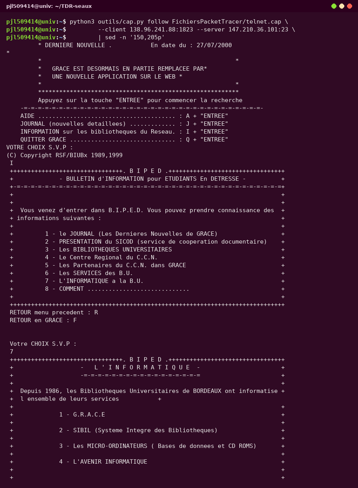

**Ce que l'utilisateur a tapé** (le sens client → serveur, seulement **117 octets**
au total) : `grace` (le login), `A`, `S`, `R`, `I`, `J`, `F`, `Q` et une dizaine de
fins de ligne. La session se lit donc intégralement, **y compris la saisie du mot
de passe** s'il y en avait un — ici il n'y a pas de `Password:` dans la trace, le
compte est passé directement.

## 4. Expliquez le résultat obtenu

**Pourquoi 126 paquets sur 178 vont-ils vers le client ?** Parce que le serveur ne
fait rien d'autre que de lui **renvoyer ce qu'il doit afficher** :

* **l'écho** : en mode caractère, le serveur renvoie **chaque touche** au fur et à
  mesure de la frappe. C'est ce que montrent les paquets de `length 1` : `g`, `r`,
  `a`, `c`, `e`… un paquet par caractère ;
* **les pages** : chaque écran de l'application (menus, aide, journal) est envoyé
  en bloc, avec les codes de positionnement du terminal (`ESC[2J` pour effacer
  l'écran, `ESC[1;1H` pour repositionner le curseur, `ESC[5m` pour le
  clignotement…). Ce sont ces séquences ANSI/VT100 que l'analyse a retirées pour
  rendre les pages lisibles ;
* **les acquittements** (`ACK`) : TCP confirme la réception de chaque segment.

**Ce que cela démontre sur le plan de la sécurité :** Telnet transporte **tout en
clair** — le login, les frappes, les menus, les données affichées. Sur un réseau
réel, **une simple capture** (ou un `tcpdump`) permet donc de reconstituer une
session complète et de récupérer un mot de passe : c'est la raison pour laquelle
Telnet doit être remplacé par **SSH** (partie III), qui chiffre toute la session.
Packet Tracer permet de simuler la vérification, mais aussi la **remise en clair**
(`tcpdump` effectué sur le lien) : le TP l'illustre exactement.

---

# Partie III — SSH

## 1. À quel serveur le client s'est-il connecté ?

**Réponse :** au serveur **`134.59.22.22`**, port **22** (le port standard de SSH).

On le voit dans les conversations de la capture, et surtout dans la première chaîne
que le serveur envoie, en clair, avant le chiffrement :

```console
pjl509414@univ:~$ python3 outils/cap.py flows FichiersPacketTracer/ssh.cap
SOURCE                 DESTINATION            PROTO  PAQUETS     OCTETS
138.96.241.55:139      138.96.241.88:4233     TCP         52      31280
131.254.254.41:36981   138.96.146.5:10000     TCP          1         60
138.195.130.71:80      138.96.241.88:1868     TCP          4        160
134.59.22.22:22        138.96.241.88:1869     TCP        319     144537
138.96.32.250          224.0.0.13             proto 103        2        108
131.254.254.41:37073   138.96.146.5:10000     TCP          1         60
138.96.241.88:1874     193.51.224.22:80       TCP         11       3618
138.96.0.39:80         138.96.219.36:4807     TCP          3        620
138.96.32.250          224.0.0.4              proto 2        1        199

9 conversation(s)
```

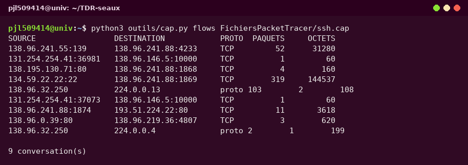

```console
SSH-2.0-OpenSSH_3.8.1p1 Debian-8.sarge.6
```

→ le serveur est `134.59.22.22` (`ssh://134.59.22.22:22`), une machine **Linux
Debian (sarge)** faisant tourner **OpenSSH 3.8.1p1**. Le client, lui, utilise le
port éphémère **1869**.

> La capture contient aussi d'autres échanges, sans rapport avec SSH : une session
> NetBIOS (`138.96.241.55:139` → `138.96.241.88:4233`), une requête HTTP
> `GET /aum.crl` vers `193.51.224.22:80` émise par **Adobe Update Manager 5**, et
> une requête vers `138.96.0.39:80`. C'est normal : on capture l'interface, pas
> seulement la connexion SSH.

## 2. Le client a-t-il utilisé un logiciel pour la connexion ? Si oui, lequel ?

**Réponse : oui — PuTTY, version 0.58** (sous Windows).

La chaîne d'identification envoyée par le client est :

```console
SSH-2.0-PuTTY_Release_0.58
```

Elle est lisible **en clair** dans la capture (les trois lignes
`SSH-2.0-…`, échangées avant la mise en place du chiffrement) :

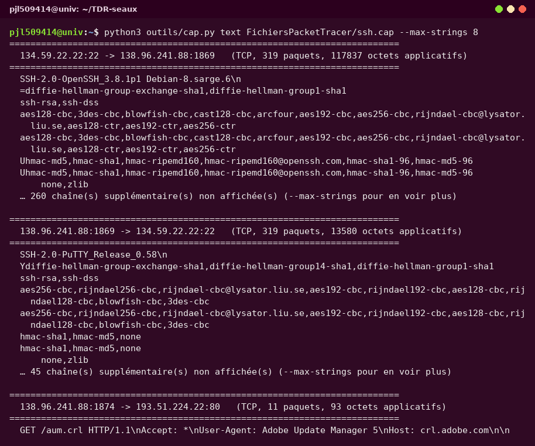

| Élément | Client | Serveur |
|---------|--------|---------|
| Logiciel | **PuTTY release 0.58** | **OpenSSH 3.8.1p1** |
| Système | Windows (PuTTY) | Debian GNU/Linux (sarge) |
| Adresse | `138.96.241.88`, port `1869` | `134.59.22.22`, port `22` |

## 3. Quelles informations voyez-vous circuler ? Commenter.

**Deux phases bien distinctes :**

**(a) Avant le chiffrement — tout est lisible.** L'identification des logiciels et
la **négociation des algorithmes** :

* échange de clés (*key exchange*) :
  `diffie-hellman-group-exchange-sha1`, `diffie-hellman-group14-sha1`,
  `diffie-hellman-group1-sha1` ;
* authentification du serveur (clés d'hôte) : `ssh-rsa`, `ssh-dss` ;
* chiffrement retenu : `aes256-cbc`, `aes192-cbc`, `aes128-cbc`, `3des-cbc`,
  `blowfish-cbc`, `arcfour`… ;
* intégrité : `hmac-sha1`, `hmac-md5`, `hmac-ripemd160` ;
* compression : `none`, `zlib`.

**(b) Après le `NEWKEYS` — plus rien n'est lisible.** Le reste de la session
(authentification de l'utilisateur, mot de passe, commandes, résultats) est
**chiffré** : on ne voit que des octets pseudo-aléatoires.

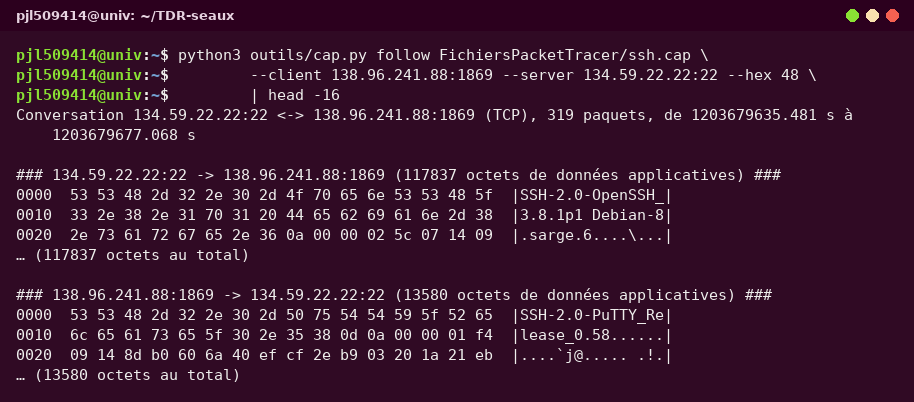

**Commentaire.** C'est **exactement la différence entre Telnet et SSH** :

| | Telnet (II) | SSH (III) |
|---|---|---|
| Port | 23 | 22 |
| Contenu de la session | **tout en clair** (login, mot de passe, données) | **chiffré** dès après la négociation |
| Ce qu'on peut lire dans une capture | toute la session | uniquement les bannières et la liste des algorithmes |
| Risque | écoute passive = vol d'identifiants | échange chiffré + authentifié (intégrité) |

SSH met en place un **canal chiffré** (ici AES ou 3DES) et **authentifié**
(HMAC + clé d'hôte) : même si quelqu'un capture le trafic, il ne peut ni lire, ni
modifier la session sans être détecté. C'est pourquoi **SSH remplace**
avantageusement `telnet`, `rlogin`, `rsh` et `ftp` (devenu `sftp`/`scp`).

Les seules informations qui « fuient » restent de nature **métadonnées** :
l'adresse du serveur, le port, et les versions des logiciels (utiles pour… savoir si
une version obsolète est utilisée, comme ici OpenSSH 3.8.1 de 2005).

---

# Annexe — les commandes utilisées

Tout a été fait depuis le terminal, avec les outils du dépôt `outils/` (aucune
dépendance, Python 3 standard) :

```bash
# Lire la maquette sans Packet Tracer : équipements, modèles, ports, IP, configs
python3 outils/pkt.py devices FichiersPacketTracer/IUT_TP_LAYER7_AConfigurer.pkt
python3 outils/pkt.py configs FichiersPacketTracer/IUT_TP_LAYER7_AConfigurer.pkt --running-only

# Extraire le XML complet d'une maquette (et le remettre au format .pkt)
python3 outils/pkt.py decode FichiersPacketTracer/IUT_TP_LAYER7_AConfigurer.pkt -o tp7.xml
python3 outils/pkt.py encode tp7.xml -o tp7.pkt

# Comprendre / vérifier / modifier un .pkt
python3 outils/pkt.py check  maquette.pkt
python3 outils/pkt.py edit   maquette.pkt --replace "hostname Switch" --with "hostname SW1" -o modifie.pkt

# Analyser les captures réseau
python3 outils/cap.py flows  FichiersPacketTracer/telnet.cap
python3 outils/cap.py filter FichiersPacketTracer/telnet.cap "ip.dst == 138.96.241.88"
python3 outils/cap.py follow FichiersPacketTracer/telnet.cap \
                  --client 138.96.241.88:1823 --server 147.210.36.101:23
python3 outils/cap.py text   FichiersPacketTracer/ssh.cap --max-strings 8

# Tout vérifier d'un coup
python3 outils/selftest.py
```

Sous **Wireshark**, les équivalents des commandes ci-dessus sont :

| Commande du terminal | Dans Wireshark |
|----------------------|----------------|
| `cap.py flows` | *Statistics → Conversations → TCP* |
| `cap.py filter "ip.dst == 138.96.241.88"` | barre de filtre : `ip.dst == 138.96.241.88` |
| `cap.py follow …` | clic droit sur un paquet → *Follow → TCP Stream* |
| `cap.py text ssh.cap` | *Analyze → Follow → TCP Stream* (ou `tcp.stream eq N`) |

---

*Document rédigé pour le TP7 « Applications » — les captures de terminal sont des
sorties réelles ; les captures Packet Tracer sont des reconstitutions fidèles des
écrans, produites par `TP7/make_screenshots.py` (voir la note en tête de document).*
